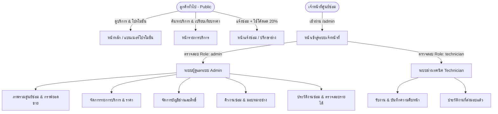
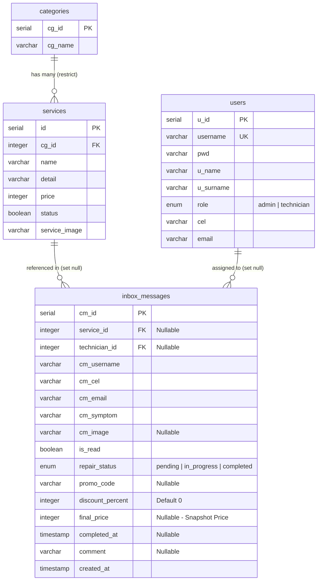

# 🛠️ FixPlease (FP) — Electronic Repair Service & Management System

ระบบแจ้งซ่อมและบริหารจัดการศูนย์ซ่อมอุปกรณ์อิเล็กทรอนิกส์ครบวงจร (**Computer PC, Laptop, Smartphone**) พัฒนาด้วยสถาปัตยกรรมแบบ **Modular Architecture** แยกส่วนระหว่าง **Frontend** (`React 19 + Vite + Tailwind CSS v4 + TypeScript`) และ **Backend** (`Bun + Express + TypeScript + Drizzle ORM + PostgreSQL`) พร้อมระบบยืนยันตัวตนผ่าน **HttpOnly Cookie**, **Zod Validation ทุก Endpoint**, **Rate Limiting** และการแบ่งสิทธิ์ผู้ใช้งานตามบทบาท (**Role-Based Access Control**)

---

## 📌 เอกสารประกอบการส่งงาน (Project Deliverables)

| เอกสาร / ไฟล์ส่งมอบ | ที่อยู่ไฟล์ในโปรเจกต์ | คำอธิบาย |
| :--- | :--- | :--- |
| **1. สรุปธุรกิจ + ภาพร่างหน้าเว็บ** | [`docs/BUSINESS_BRIEF.md`](./docs/BUSINESS_BRIEF.md) | สรุปปัญหาธุรกิจ โซลูชัน แผนผัง User Flow และ Wireframes ทุกหน้า |
| **2. ผังตารางฐานข้อมูล (ER Diagram)** | [`docs/DATABASE_SCHEMA.md`](./docs/DATABASE_SCHEMA.md) | แผนผัง ER Diagram, พจนานุกรมข้อมูล (Data Dictionary) และ Indexes |
| **3. ไฟล์ทดสอบ API (REST Client)** | [`docs/api-tests.http`](./docs/api-tests.http) | ไฟล์ทดสอบ API ครบทุก Endpoint สำหรับ VS Code REST Client |
| **4. ไฟล์ทดสอบ API (Postman)** | [`docs/postman_collection.json`](./docs/postman_collection.json) | ไฟล์ Collection สำหรับ Import เข้า Postman / Thunder Client / Bruno |

---

## 📋 สารบัญ (Table of Contents)

1. [สรุปธุรกิจและภาพรวมบทบาทผู้ใช้งาน](#-1-สรุปธุรกิจและภาพรวมบทบาทผู้ใช้งาน)
2. [สถาปัตยกรรมและโครงสร้างโปรเจกต์แบบ Module](#-2-สถาปัตยกรรมและโครงสร้างโปรเจกต์แบบ-module)
3. [ขั้นตอนการติดตั้งและเริ่มใช้งาน (Getting Started)](#-3-ขั้นตอนการติดตั้งและเริ่มใช้งาน-getting-started)
4. [ผังตารางฐานข้อมูล (ER Diagram & Schema)](#-4-ผังตารางฐานข้อมูล-er-diagram--schema)
5. [ตารางสรุป API Endpoints และการทดสอบ API](#-5-ตารางสรุป-api-endpoints-และการทดสอบ-api)
6. [มาตรฐานความปลอดภัย SEO และการล็อกยอดขาย](#-6-มาตรฐานความปลอดภัย-seo-และการล็อกยอดขาย)
7. [ภาพร่างหน้าเว็บ (Wireframes Summary)](#-7-ภาพร่างหน้าเว็บ-wireframes-summary)

---

## 🌟 1. สรุปธุรกิจและภาพรวมบทบาทผู้ใช้งาน

**FixPlease (FP)** คือระบบบริหารจัดการร้านซ่อมอุปกรณ์อิเล็กทรอนิกส์ที่ออกแบบมาเพื่อแก้ปัญหา **ความไม่ชัดเจนของราคาประเมินซ่อม** และ **การตกหล่นของคิวงานซ่อมหลังบ้าน** โดยแบ่งผู้ใช้งานออกเป็น 3 บทบาทหลัก:



### 1.1 ลูกค้าทั่วไป (Public Customers — 3 หน้าหลัก)
- **หน้าหลัก (`/`)**: แบนเนอร์โปรโมชั่นส่วนลด 20% (`HALLOWEEN20`), หมวดหมู่บริการซ่อม, บริการยอดนิยม และจุดเด่นของศูนย์บริการ
- **หน้ารวมบริการ (`/services`)**: ค้นหาบริการตามชื่อหรืออาการเสีย กรองตามหมวดหมู่ (`Computer`, `Laptop`, `Phone`) และกดปุ่ม **"ส่งซ่อมบริการนี้"** เพื่อส่งค่าไปยังฟอร์มแจ้งซ่อมทันที
- **หน้าเกี่ยวกับเราและฟอร์มแจ้งซ่อม (`/about`)**:
  - แสดงข้อมูลศูนย์ซ่อม เวลาทำการ ช่องทางติดต่อ และมาตรฐานการรับประกัน
  - แบบฟอร์มแจ้งซ่อมออนไลน์ที่รองรับทั้ง **การเลือกบริการล่วงหน้า** และตัวเลือก **"ไม่แน่ใจอาการ / ปรึกษาช่างก่อน (`service_id = null`)"**
  - รองรับการกรอกโค้ดส่วนลด (`HALLOWEEN20`, `PROMO20`, `FIX20`) เพื่อลดราคาค่าซ่อม 20% อัตโนมัติ

### 1.2 ช่างเทคนิค (Technician)
- เข้าสู่ระบบผ่าน `/admin`
- **จำกัดสิทธิ์การเข้าถึง:** เข้าถึงได้เฉพาะหน้า **คิวงานซ่อม (`/admin/inbox`)** และ **ประวัติการซ่อม (`/admin/history`)** เท่านั้น (ไม่สามารถเข้าดู Dashboard ภาพรวมรายได้, จัดการบริการ หรือจัดการผู้ใช้ได้)
- **การรับงานและซ่อม:**
  - กดรับงานที่ยังไม่มีผู้รับผิดชอบ ระบบจะผูกชื่อช่างคนนั้นเข้ากับใบงานอัตโนมัติ
  - แก้ไขสถานะ (`pending` ➔ `in_progress` ➔ `completed`), เลือกบริการที่ซ่อมจริง และบันทึกหมายเหตุการซ่อมได้ **เฉพาะงานของตนเองหรืองานว่างเท่านั้น** (ห้ามแก้งานของช่างคนอื่น และไม่มีปุ่มลบใบงาน)

### 1.3 ผู้ดูแลระบบ / เจ้าของร้าน (Admin)
- เข้าถึงได้ทุกฟังก์ชันหลังบ้าน:
  - **Dashboard (`/admin/dashboard`)**: ดูรายรับรวม, รายสัปดาห์ (7 วัน), รายเดือน (30 วัน), สัดส่วนรายได้ตามหมวดหมู่ และ **ตารางสถิติผลงานของช่างแต่ละคน**
  - **จัดการบริการ (`/admin/services`)**: เพิ่ม, แก้ไข, ลบ, เปิด/ปิดสถานะบริการซ่อม (เมื่อแก้ไขแล้วหน้าเว็บลูกค้าจะอัปเดตทันที)
  - **คิวงานซ่อม (`/admin/inbox`)**: ดูใบแจ้งซ่อมทั้งหมด, มอบหมายหรือเปลี่ยนช่างผู้รับผิดชอบ, อัปเดตสถานะ และลบใบงานที่ยังไม่ปิดงาน
  - **ประวัติการซ่อม (`/admin/history`)**: ตรวจสอบใบงานที่ส่งมอบแล้ว (`completed`) พร้อมราคาสุทธิที่ถูกล็อกไว้
  - **จัดการผู้ใช้งาน (`/admin/users`)**: เพิ่ม, แก้ไข, เปลี่ยนสิทธิ์ (`admin` / `technician`), รีเซ็ตรหัสผ่าน และลบบัญชีเจ้าหน้าที่

---

## 📁 2. สถาปัตยกรรมและโครงสร้างโปรเจกต์แบบ Module

โปรเจกต์จัดระเบียบแบบ **Feature-Based Modular Architecture** โดยแยกแต่ละฟีเจอร์ในฝั่ง Backend ออกเป็นโมดูลอิสระภายใต้ `backend/src/modules/` เพื่อให้ง่ายต่อการดูแลรักษาและขยายระบบ:

```text
Starter-Website-Intern/
├── api/
│   └── index.ts                         # Serverless Entrypoint สำหรับ Vercel
├── backend/                             # Backend Server (Bun + Express + Drizzle ORM)
│   ├── drizzle/                         # SQL Migrations (0000 - 0004)
│   ├── src/
│   │   ├── config/
│   │   │   ├── db.ts                    # การเชื่อมต่อ PostgreSQL & Drizzle Instance
│   │   │   └── env.ts                   # ตรวจสอบ Environment Variables & CORS Whitelist
│   │   ├── db/
│   │   │   ├── schema.ts                # ตารางฐานข้อมูล, Enums, Relations และ Indexes
│   │   │   └── seed.ts                  # สคริปต์สร้างข้อมูลเริ่มต้นและบัญชีผู้ใช้จาก .env
│   │   ├── middlewares/
│   │   │   ├── auth.middleware.ts       # ตรวจสอบ JWT ใน HttpOnly Cookie + เช็ค DB สดทุกครั้ง
│   │   │   ├── role.middleware.ts       # แยกสิทธิ์ requireAdmin และ requireStaff
│   │   │   ├── rateLimit.middleware.ts  # จำกัดความถี่การล็อกอินและการส่งฟอร์มแจ้งซ่อม
│   │   │   ├── validate.middleware.ts   # Middleware ตรวจสอบข้อมูลด้วย Zod Schema
│   │   │   └── error.middleware.ts      # Global Error Handler
│   │   ├── modules/                     # 📦 Feature Modules (Controller + Routes + Zod Schema)
│   │   │   ├── auth/                    # โมดูลยืนยันตัวตน (auth.controller, auth.routes, auth.schema)
│   │   │   ├── categories/              # โมดูลหมวดหมู่บริการ (categories.controller, routes, schema)
│   │   │   ├── services/                # โมดูลรายการบริการซ่อม (services.controller, routes, schema)
│   │   │   ├── inbox/                   # โมดูลใบแจ้งซ่อมและคิวงาน (inbox.controller, routes, schema)
│   │   │   ├── users/                   # โมดูลจัดการผู้ใช้งาน (users.controller, routes, schema)
│   │   │   ├── dashboard/               # โมดูลคำนวณสถิติและรายได้ (dashboard.controller, routes)
│   │   │   └── index.ts                 # รวมเส้นทาง API ของทุก Module
│   │   ├── types/
│   │   │   └── auth.ts                  # TypeScript Interfaces สำหรับ Express Request
│   │   └── index.ts                     # Express App Entrypoint
│   ├── .env.example                     # ตัวอย่างการตั้งค่า Environment Variables
│   └── package.json
├── frontend/                            # Frontend Client (React 19 + Vite + Tailwind CSS v4)
│   ├── index.html                       # HTML หลักพร้อม SEO Meta Tags & Open Graph Cards
│   ├── src/
│   │   ├── api/client.ts                # Fetch Wrapper พร้อม credentials: 'include'
│   │   ├── components/                  # Navbar, Footer, ImageLightbox
│   │   ├── context/                     # AuthContext & ServiceContext
│   │   ├── pages/                       # หน้าเว็บแยกตามโมดูล (Home, Services, AboutMe, Login, Admin)
│   │   ├── types/index.ts               # TypeScript Interfaces ฝั่ง Frontend
│   │   └── App.tsx                      # React Router & Role Protection
│   └── package.json
├── docs/                                # 📄 เอกสารส่งมอบงานและไฟล์ทดสอบ API
│   ├── BUSINESS_BRIEF.md                # สรุปธุรกิจและภาพร่างหน้าเว็บ (Wireframes)
│   ├── DATABASE_SCHEMA.md               # ผังตาราง ER Diagram และ Data Dictionary
│   ├── api-tests.http                   # ไฟล์ทดสอบ API สำหรับ VS Code REST Client
│   └── postman_collection.json          # ไฟล์ทดสอบ API สำหรับ Postman
├── package.json                         # Root Workspace Scripts (start:all, build)
└── README.md                            # เอกสารคู่มือหลักของโปรเจกต์
```

---

## 🚀 3. ขั้นตอนการติดตั้งและเริ่มใช้งาน (Getting Started)

### ความต้องการของระบบ (Prerequisites)
- **Bun** `>= 1.1` (หรือ Node.js `>= 20`)
- **PostgreSQL** `>= 15` (Local PostgreSQL หรือ Cloud เช่น Neon Database)

### ขั้นตอนที่ 1: ติดตั้ง Dependencies

เปิด Terminal ที่โฟลเดอร์หลักของโปรเจกต์ แล้วรันคำสั่ง:

```bash
# ติดตั้ง dependencies ฝั่ง Backend
cd backend
bun install

# ติดตั้ง dependencies ฝั่ง Frontend
cd ../frontend
bun install
cd ..
```

### ขั้นตอนที่ 2: ตั้งค่าไฟล์ `.env`

คัดลอกไฟล์ `backend/.env.example` ไปเป็น `backend/.env` แล้วกำหนดค่าดังนี้:

```env
# Server Configuration
PORT=5000
NODE_ENV=development
CLIENT_URL=http://localhost:3000

# PostgreSQL Connection String
DATABASE_URL=postgresql://<user>:<password>@<host>:5432/<dbname>

# JWT & Cookie Secret Key (จำเป็นต้องระบุ หากไม่ระบุเซิร์ฟเวอร์จะไม่ยอมสตาร์ท)
JWT_SECRET=your_super_secret_jwt_key_here

# ข้อมูลบัญชีเริ่มต้นสำหรับคำสั่ง Seed (bun run db:seed)
SEED_ADMIN_USERNAME=Admin
SEED_ADMIN_PASSWORD=<your-admin-password>
SEED_TECH_USERNAME=TechSomchai
SEED_TECH_PASSWORD=<your-technician-password>
```

### ขั้นตอนที่ 3: สร้างตารางฐานข้อมูลและข้อมูลเริ่มต้น (Migration & Seed)

```bash
cd backend
bun run db:push
bun run db:seed
cd ..
```

### ขั้นตอนที่ 4: รันระบบ (Development Mode)

#### วิธีที่ 1: รันพร้อมกันทั้ง Frontend และ Backend ด้วยคำสั่งเดียว (แนะนำ)
จากโฟลเดอร์หลัก (Root):
```bash
bun run start:all
```

#### วิธีที่ 2: รันแยก 2 หน้าต่าง Terminal
**Terminal 1 (Backend API — พอร์ต 5000):**
```bash
cd backend
bun run dev
```

**Terminal 2 (Frontend Web — พอร์ต 3000):**
```bash
cd frontend
bun run dev
```

- 🌐 **หน้าเว็บลูกค้า:** `http://localhost:3000`
- 🔐 **หน้าจัดการหลังบ้าน (Admin / ช่าง):** `http://localhost:3000/admin`
- 📡 **ตรวจสอบสถานะ API:** `http://localhost:5000/api/health`

---

## 🗄️ 4. ผังตารางฐานข้อมูล (ER Diagram & Schema)

ดูรายละเอียดพจนานุกรมข้อมูลฉบับเต็มได้ที่ [`docs/DATABASE_SCHEMA.md`](./docs/DATABASE_SCHEMA.md)



### คำสั่งจัดการฐานข้อมูล (`backend/package.json`)
| คำสั่ง | คำอธิบาย |
| :--- | :--- |
| `bun run db:push` | ซิงค์โครงสร้างตารางจาก Drizzle Schema ไปยังฐานข้อมูล PostgreSQL |
| `bun run db:generate` | สร้างไฟล์ SQL Migration ลงในโฟลเดอร์ `backend/drizzle/` |
| `bun run db:migrate` | รันไฟล์ SQL Migration ไปยังฐานข้อมูล |
| `bun run db:seed` | สร้างหมวดหมู่เริ่มต้น, บริการตัวอย่าง และซิงค์บัญชีผู้ใช้เริ่มต้นจาก `.env` |
| `bun run db:studio` | เปิด Drizzle Studio เพื่อดูและจัดการข้อมูลผ่านหน้าเว็บ |

---

## 📡 5. ตารางสรุป API Endpoints และการทดสอบ API

สามารถเปิดไฟล์ [`docs/api-tests.http`](./docs/api-tests.http) ใน VS Code (ด้วยส่วนเสริม REST Client) หรือนำเข้า [`docs/postman_collection.json`](./docs/postman_collection.json) ลงใน Postman เพื่อยิงทดสอบได้ทันที

### 5.1 โมดูลการยืนยันตัวตน (`/api/auth`)
| Method | Endpoint | สิทธิ์การเข้าถึง | Zod Validation | คำอธิบาย |
| :--- | :--- | :--- | :---: | :--- |
| `POST` | `/api/auth/login` | Public (Rate Limited) | `loginSchema` | เข้าสู่ระบบและรับ HttpOnly Cookie (`auth_token`) |
| `POST` | `/api/auth/logout` | Public | - | ออกจากระบบและล้าง HttpOnly Cookie |
| `GET` | `/api/auth/me` | Public | - | ตรวจสอบสถานะผู้ใช้งานปัจจุบันและ Role ล่าสุดจากฐานข้อมูล |

### 5.2 โมดูลหมวดหมู่บริการ (`/api/categories`)
| Method | Endpoint | สิทธิ์การเข้าถึง | Zod Validation | คำอธิบาย |
| :--- | :--- | :--- | :---: | :--- |
| `GET` | `/api/categories` | Public | - | ดึงรายการหมวดหมู่ทั้งหมด (`Computer`, `Laptop`, `Phone`) |
| `GET` | `/api/categories/:id` | Public | - | ดึงข้อมูลหมวดหมู่ตาม ID |
| `POST` | `/api/categories` | **Admin Only** | `createCategorySchema` | เพิ่มหมวดหมู่บริการใหม่ |

### 5.3 โมดูลรายการบริการซ่อม (`/api/services`)
| Method | Endpoint | สิทธิ์การเข้าถึง | Zod Validation | คำอธิบาย |
| :--- | :--- | :--- | :---: | :--- |
| `GET` | `/api/services` | Public | - | ดึงรายการบริการทั้งหมด (รองรับ `?cg_id=1&status=true`) |
| `GET` | `/api/services/:id` | Public | - | ดึงข้อมูลบริการรายตัวตาม ID |
| `POST` | `/api/services` | **Admin Only** | `createServiceSchema` | เพิ่มรายการบริการซ่อมใหม่ |
| `PUT` | `/api/services/:id` | **Admin Only** | `updateServiceSchema` | แก้ไขข้อมูลบริการ ราคา หรือสถานะเปิด/ปิด |
| `DELETE` | `/api/services/:id` | **Admin Only** | - | ลบรายการบริการ |

### 5.4 โมดูลใบแจ้งซ่อมและคิวงาน (`/api/inbox`)
| Method | Endpoint | สิทธิ์การเข้าถึง | Zod Validation | คำอธิบาย |
| :--- | :--- | :--- | :---: | :--- |
| `POST` | `/api/inbox` | Public (Rate Limited) | `createInboxMessageSchema` | ลูกค้าส่งฟอร์มแจ้งซ่อม (รองรับโค้ดส่วนลด 20%) |
| `GET` | `/api/inbox` | **Staff (Admin & Tech)** | - | ดึงรายการใบแจ้งซ่อมพร้อมตัวกรองสถานะ/หมวดหมู่/ช่าง |
| `GET` | `/api/inbox/:id` | **Staff (Admin & Tech)** | - | ดูรายละเอียดใบแจ้งซ่อมตาม ID (ไม่มี Side Effect) |
| `PATCH` | `/api/inbox/:id/read` | **Staff (Admin & Tech)** | - | เปลี่ยนสถานะข้อความเป็น "อ่านแล้ว (`is_read = true`)" |
| `PATCH` | `/api/inbox/:id/status`| **Staff (Admin & Tech)** | `updateInboxStatusSchema` | อัปเดตสถานะการซ่อม, มอบหมายช่าง, และล็อก `final_price` เมื่อปิดงาน |
| `DELETE` | `/api/inbox/:id` | **Admin Only** | - | ลบใบแจ้งซ่อม (ไม่อนุญาตให้ลบใบงานที่ส่งมอบแล้ว) |

### 5.5 โมดูลจัดการผู้ใช้งาน (`/api/users`)
| Method | Endpoint | สิทธิ์การเข้าถึง | Zod Validation | คำอธิบาย |
| :--- | :--- | :--- | :---: | :--- |
| `GET` | `/api/users` | **Staff (Admin & Tech)** | - | ดึงรายชื่อผู้ใช้และช่าง (ไม่ส่งฟิลด์รหัสผ่าน `pwd` กลับไป) |
| `GET` | `/api/users/:id` | **Admin Only** | - | ดูข้อมูลผู้ใช้รายบุคคลตาม ID |
| `POST` | `/api/users` | **Admin Only** | `createUserSchema` | สร้างบัญชีผู้ใช้ใหม่พร้อมแฮชรหัสผ่านด้วย `bcrypt` |
| `PUT` | `/api/users/:id` | **Admin Only** | `updateUserSchema` | แก้ไขข้อมูลผู้ใช้ สิทธิ์การใช้งาน หรือเปลี่ยนรหัสผ่าน |
| `DELETE` | `/api/users/:id` | **Admin Only** | - | ลบบัญชีผู้ใช้งาน (มีระบบป้องกันการลบบัญชีตัวเอง) |

### 5.6 โมดูลแดชบอร์ดและสถิติ (`/api/dashboard`)
| Method | Endpoint | สิทธิ์การเข้าถึง | Zod Validation | คำอธิบาย |
| :--- | :--- | :--- | :---: | :--- |
| `GET` | `/api/dashboard` | **Admin Only** | - | ดึงสถิติรายรับรวม/รายสัปดาห์/รายเดือน และผลงานของช่างแต่ละคน |

---

## 🔒 6. มาตรฐานความปลอดภัย SEO และการล็อกยอดขาย

1. **Password Hashing (`bcrypt`)**: รหัสผ่านทุกบัญชีในฐานข้อมูลถูกเข้ารหัสทางเดียวด้วย `bcryptjs` (Salt rounds = 10) ไม่มีการเก็บรหัสผ่านจริง (Plaintext)
2. **HttpOnly Cookie & Live DB Verification**:
   - เก็บ JWT Token ใน Cookie ที่ตั้งค่า `httpOnly: true`, `sameSite: 'lax'`, `secure: true` (ใน Production) ป้องกันการโจรกรรมผ่าน XSS
   - ทุกครั้งที่เรียก API หลังบ้าน `auth.middleware.ts` จะตรวจสอบ `u_id` และ `role` ล่าสุดจากฐานข้อมูลจริงทันที หากผู้ใช้ถูกลบหรือเปลี่ยนสิทธิ์จะมีผลในวินาทีนั้นทันที
3. **Rate Limiting**:
   - จำกัดการยิง `POST /api/auth/login` ไม่เกิน 30 ครั้ง / 1 นาที ต่อ IP (และรีเซ็ตอัตโนมัติเมื่อล็อกอินสำเร็จ)
   - จำกัดการส่งฟอร์ม `POST /api/inbox` ไม่เกิน 10 ครั้ง / 15 นาที ต่อ IP ป้องกันบอทสแปม
4. **CORS Whitelist & Fail-Fast Secret**:
   - อนุญาตเฉพาะ Origin ที่ระบุใน `CLIENT_URL` เท่านั้น และบังคับตั้งค่า `JWT_SECRET` ใน `.env` ก่อนสตาร์ทเซิร์ฟเวอร์เสมอ
5. **Revenue Snapshot (`final_price` & `completed_at`)**:
   - เมื่อปิดงานซ่อมเป็น `completed` ระบบจะคำนวณราคาสุทธิหลังหักส่วนลดแล้วบันทึกลงคอลัมน์ `final_price` พร้อมเวลา `completed_at` ถาวร ทำให้การแก้ไขราคาบริการหรือลบบริการในอนาคตไม่ทำให้ยอดขายย้อนหลังคลาดเคลื่อน
6. **SEO & Open Graph Cards**:
   - กำหนด `<title>`, `<meta name="description">`, Open Graph (`og:title`, `og:description`, `og:image`) และ Twitter Cards ใน `frontend/index.html` ครบถ้วน

---

## 🎨 7. ภาพร่างหน้าเว็บ (Wireframes Summary)

ดูภาพร่างหน้าเว็บครบทุกหน้าพร้อมรายละเอียดได้ที่ [`docs/BUSINESS_BRIEF.md`](./docs/BUSINESS_BRIEF.md#-3-ภาพร่างหน้าเว็บ-wireframes)
