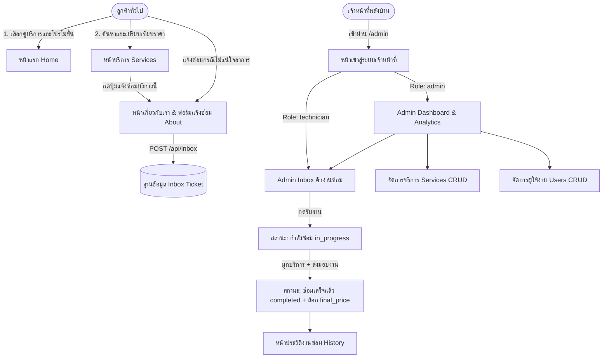

# 📋 สรุปธุรกิจและภาพร่างหน้าเว็บ (Business Brief & Wireframes)

เอกสารฉบับนี้รวบรวม **สรุปภาพรวมธุรกิจ (Business Brief)** และ **ภาพร่างโครงสร้างหน้าเว็บ (Wireframes)** สำหรับระบบ **FixPlease — ศูนย์บริการซ่อมอุปกรณ์อิเล็กทรอนิกส์ครบวงจร** ตามข้อกำหนดการส่งงาน

---

## 🏢 1. สรุปธุรกิจ (Business Brief)

### 1.1 ข้อมูลธุรกิจ
- **ชื่อธุรกิจ:** FixPlease (FP) — Electronic Repair Service & Management Center
- **ประเภทธุรกิจ:** ศูนย์บริการตรวจเช็คและซ่อมแซมอุปกรณ์อิเล็กทรอนิกส์ครบวงจร (Computer PC, Laptop/MacBook, Smartphone/Tablet)
- **แนวคิดหลัก (Core Value):** *"ซ่อมไว โปร่งใส รู้ราคาก่อนซ่อม ตรวจสอบมาตรฐานโดยทีมช่างผู้เชี่ยวชาญ"*

### 1.2 ปัญหาของร้านซ่อมแบบดั้งเดิม (Pain Points)
1. **ฝั่งลูกค้า:**
   - ไม่ทราบราคามาตรฐานล่วงหน้า กลัวถูกบวกราคาเกินจริงเมื่อนำเครื่องไปหน้าร้าน
   - ไม่แน่ใจว่าอาการเสียของตัวเองจัดอยู่ในบริการหมวดไหน ต้องเสียเวลาเดินทางไปถามที่ร้านก่อน
2. **ฝั่งช่างซ่อมและเจ้าของร้าน:**
   - การรับแจ้งซ่อมผ่านแชทหลายช่องทางทำให้ข้อมูลอาการเสีย เบอร์ติดต่อ หรือรูปถ่ายความเสียหายตกหล่น
   - ไม่รู้ว่างานชิ้นไหนช่างคนใดเป็นผู้รับผิดชอบ หรือกำลังค้างอยู่ที่ขั้นตอนไหน (`รอซ่อม` หรือ `กำลังซ่อม`)
   - การคำนวณรายรับย้อนหลังผิดพลาดเมื่อมีการปรับเปลี่ยนราคาบริการในภายหลัง

### 1.3 โซลูชันที่ระบบ FixPlease แก้ไข (Key Solutions)
1. **Public Service Catalog:** แสดงรายการบริการซ่อมแยกตามหมวดหมู่ (`Computer`, `Laptop`, `Phone`) พร้อมราคามาตรฐานชัดเจน
2. **Flexible Online Repair Booking:** ลูกค้าสามารถกดเลือกบริการแล้วส่งต่อเข้าฟอร์มแจ้งซ่อมอัตโนมัติ หรือเลือก *"ไม่แน่ใจอาการ / ปรึกษาช่างก่อน"* เพื่อให้ช่างประเมินภายหลังได้ พร้อมรองรับโค้ดส่วนลดโปรโมชั่น (`HALLOWEEN20` ลด 20%)
3. **Role-Based Backoffice:**
   - **Admin (เจ้าของร้าน):** ดู Dashboard สรุปยอดขายรายสัปดาห์/รายเดือน จัดการบริการ จัดการบัญชีช่าง มอบหมายงาน และดูสถิติผลงานช่างรายบุคคล
   - **Technician (ช่างเทคนิค):** เข้าถึงเฉพาะคิวงานซ่อม (`Inbox`) และประวัติงานซ่อม (`History`) กดรับงาน บันทึกความคืบหน้า และส่งมอบงานได้โดยไม่เห็นข้อมูลการเงินภาพรวมหรือจัดการผู้ใช้คนอื่น
4. **Financial Snapshot Integrity:** เมื่อส่งมอบงาน (`completed`) ระบบจะล็อกราคาสุทธิ (`final_price`) และเวลาที่ซ่อมเสร็จ (`completed_at`) ลงในใบงานทันที ทำให้การแก้ราคาบริการในอนาคตไม่กระทบยอดขายย้อนหลัง

---

## 🔄 2. แผนผังการไหลของระบบ (User Journey & Workflow)



---

## 🎨 3. ภาพร่างหน้าเว็บ (Wireframes)

### 3.1 หน้าเว็บฝั่งลูกค้า (Public Pages — 3 หน้าหลัก)

#### (1) หน้าแรก — Home Page (`/`)
```text
+-----------------------------------------------------------------------+
| [FP Logo] FixPlease          Home   Services   About Me    [แจ้งซ่อม] |
+-----------------------------------------------------------------------+
|  [ แบนเนอร์โปรโมชั่นพิเศษ: โค้ด HALLOWEEN20 ลดค่าบริการซ่อมทันที 20% ]  |
+-----------------------------------------------------------------------+
|  HERO SECTION                                                         |
|  "ศูนย์ซ่อมคอมพิวเตอร์ โน้ตบุ๊ก และสมาร์ตโฟนครบวงจร"                  |
|  [ดูบริการทั้งหมด]  [ปรึกษาช่าง / แจ้งซ่อม]        [ ภาพศูนย์บริการ ] |
+-----------------------------------------------------------------------+
|  หมวดหมู่บริการหลัก (3 การ์ด)                                         |
|  +-------------------+  +-------------------+  +-------------------+  |
|  | 💻 Computer PC    |  |  ноутбук Laptop    |  | 📱 Smartphone     |  |
|  +-------------------+  +-------------------+  +-------------------+  |
+-----------------------------------------------------------------------+
|  บริการยอดนิยม (ดึงจาก API /api/services)                             |
|  +-------------------+  +-------------------+  +-------------------+  |
|  | [รูปบริการ]       |  | [รูปบริการ]       |  | [รูปบริการ]       |  |
|  | ชื่อบริการ        |  | ชื่อบริการ        |  | ชื่อบริการ        |  |
|  | ฿1,800 [ส่งซ่อม]  |  | ฿2,500 [ส่งซ่อม]  |  | ฿1,500 [ส่งซ่อม]  |  |
|  +-------------------+  +-------------------+  +-------------------+  |
+-----------------------------------------------------------------------+
|  FOOTER: ข้อมูลติดต่อร้าน | เวลาทำการ | ลิงก์เมนูด่วน                 |
+-----------------------------------------------------------------------+
```

#### (2) หน้ารวมบริการ — Services Page (`/services`)
```text
+-----------------------------------------------------------------------+
| [FP Logo] FixPlease          Home  *Services*  About Me    [แจ้งซ่อม] |
+-----------------------------------------------------------------------+
|  รายการบริการและอัตราค่าบริการมาตรฐาน                                  |
|  [ 🔍 ค้นหาชื่อบริการหรืออาการเสีย... ]                                |
|  ตัวกรองหมวดหมู่: ( ทั้งหมด ) ( Computer ) ( Laptop ) ( Phone )        |
+-----------------------------------------------------------------------+
|  หมวดหมู่: Computer                                                   |
|  +---------------------------------+ +------------------------------+ |
|  | [รูปภาพ] ซ่อมเมนบอร์ด PC        | | [รูปภาพ] ลง OS & กู้ข้อมูล   | |
|  | รายละเอียดการตรวจเช็ค...        | | รายละเอียดการกู้ข้อมูล...    | |
|  | ราคาเริ่มต้น ฿1,800  [เลือกซ่อม]| | ราคาเริ่มต้น ฿650 [เลือกซ่อม]| |
|  +---------------------------------+ +------------------------------+ |
|  หมวดหมู่: Laptop / Phone ...                                         |
+-----------------------------------------------------------------------+
```

#### (3) หน้าเกี่ยวกับเราและแบบฟอร์มแจ้งซ่อม — About Me & Contact Us (`/about`)
```text
+-----------------------------------------------------------------------+
| [FP Logo] FixPlease          Home   Services  *About Me*   [แจ้งซ่อม] |
+-----------------------------------------------------------------------+
|  เกี่ยวกับศูนย์ซ่อม FixPlease & มาตรฐานการรับประกันงานซ่อม            |
|  +---------------------+ +---------------------+ +------------------+ |
|  | 📍 ที่ตั้งศูนย์ซ่อม | | 📞 เบอร์โทรติดต่อ   | | 🕒 เวลาทำการ     | |
|  +---------------------+ +---------------------+ +------------------+ |
+-----------------------------------------------------------------------+
|  📝 แบบฟอร์มแจ้งซ่อมออนไลน์ / ปรึกษาช่าง (Contact Us)                 |
|  +------------------------------------------------------------------+ |
|  | 1. เลือกบริการที่ต้องการซ่อม:                                    | |
|  |    [v ไม่แน่ใจอาการ / ปรึกษาช่างก่อน (หรือบริการที่เลือกมา)    ] | |
|  | 2. โค้ดส่วนลดโปรโมชั่น: [ HALLOWEEN20 ] [กดใช้โค้ดลด 20%]       | |
|  | 3. ชื่อ-นามสกุลผู้ติดต่อ: [ คุณสมศรี ใจดี                      ] | |
|  | 4. เบอร์โทรศัพท์ (10 หลัก): [ 0812345678 ] 5. อีเมล: [ ...     ] | |
|  | 6. รายละเอียดอาการเสีย: [ เครื่องเปิดไม่ติด มีเสียงพัดลมดัง... ] | |
|  | 7. ลิงก์รูปภาพประกอบ (ถ้ามี): [ https://...                    ] | |
|  |                                                                  | |
|  |                [ 🚀 ยืนยันส่งข้อมูลแจ้งซ่อม ]                     | |
|  +------------------------------------------------------------------+ |
+-----------------------------------------------------------------------+
```

---

### 3.2 หน้าจัดการหลังบ้าน (Admin & Technician Portal — `/admin/*`)

#### (1) หน้า Dashboard สรุปผล (`/admin/dashboard` — เฉพาะ Admin)
```text
+------------------+----------------------------------------------------+
| SIDEBAR (Sticky) |  ADMIN DASHBOARD                      [🔄 รีเฟรช] |
| - Dashboard      |  ตัวกรองช่วงเวลา: [ทั้งหมด] [7 วัน] [30 วัน]       |
| - จัดการบริการ   +----------------------------------------------------+
| - คิวงานซ่อม (3) |  +------------+ +------------+ +-------+ +-------+ |
| - ประวัติการซ่อม |  | รายรับรวม  | | ซ่อมเสร็จ  | | รอซ่อม| | จำนวน | |
| - จัดการผู้ใช้   |  | ฿24,500    | | 14 รายการ  | | 3 งาน | | ช่าง  | |
|                  |  +------------+ +------------+ +-------+ +-------+ |
| [ออกจากระบบ]     +----------------------------------------------------+
|                  |  สัดส่วนรายรับตามหมวดหมู่ | กิจกรรมงานซ่อมล่าสุด   |
|                  +----------------------------------------------------+
|                  |  ตารางสถิติและผลงานของช่างแต่ละคน                  |
|                  |  ชื่อช่าง | งานกำลังทำ | ซ่อมเสร็จ | ยอดรวม | [ดู] |
+------------------+----------------------------------------------------+
```

#### (2) หน้าจัดการคิวงานซ่อม (`/admin/inbox` — Admin & Technician)
```text
+------------------+----------------------------------------------------+
| SIDEBAR (Sticky) |  คิวงานแจ้งซ่อม (INBOX)               [🔄 รีเฟรช] |
|                  |  แท็บสถานะ: [คิวงานทั้งหมด] [รอรับงาน] [กำลังซ่อม] |
|                  |  ตัวกรอง: [สถานะการอ่าน] [หมวดหมู่] [ช่างผู้ดูแล]  |
|                  +----------------------------------------------------+
|                  |  ตารางรายการใบแจ้งซ่อม                             |
|                  |  #ID | ลูกค้า | บริการ/อาการ | ช่าง | สถานะ | จัดการ|
|                  +----------------------------------------------------+
|                  |  [MODAL รายละเอียดใบงานซ่อม — คลิกนอกกรอบเพื่อปิด] |
|                  |  +----------------------+------------------------+ |
|                  |  | ข้อมูลลูกค้า         | อาการเสีย & รูปประกอบ  | |
|                  |  | เลือกบริการที่ซ่อม   | ช่องบันทึกความเห็นช่าง | |
|                  |  | มอบหมายช่างผู้ดูแล   | [รับงาน] [ส่งมอบงาน]   | |
|                  |  +----------------------+------------------------+ |
+------------------+----------------------------------------------------+
```

