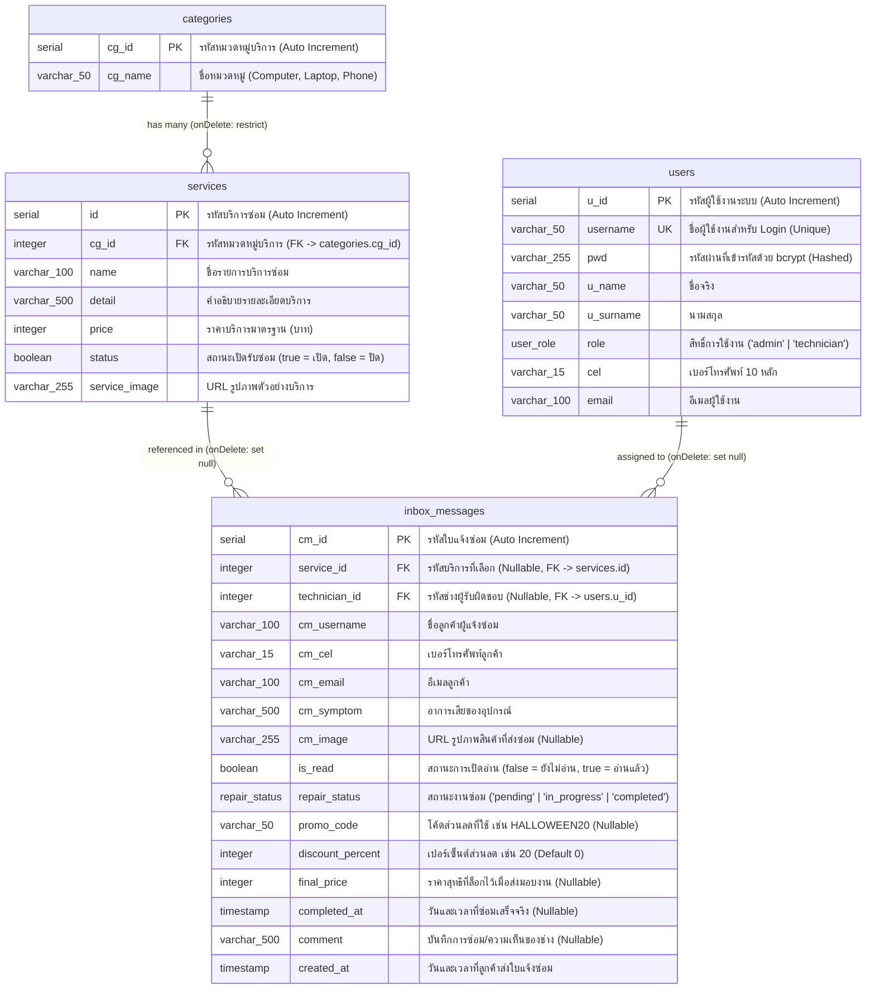

# 🗄️ ผังตารางฐานข้อมูลและพจนานุกรมข้อมูล (Database Schema & ER Diagram)

ระบบฐานข้อมูลใช้ **PostgreSQL** ร่วมกับ **Drizzle ORM** (`backend/src/db/schema.ts`) โดยออกแบบให้มีความถูกต้องของความสัมพันธ์ (Referential Integrity), มี Enum ล็อกค่าสถานะ, และมี Index สำหรับคอลัมน์ที่ใช้ค้นหาหรือกรองข้อมูลทั้งหมด

---

## 📐 1. แผนผังความสัมพันธ์ของตาราง (ER Diagram)

---

## 📋 2. พจนานุกรมข้อมูล (Data Dictionary)

### 2.1 ตาราง `categories` (หมวดหมู่บริการซ่อม)
| ชื่อคอลัมน์ | ชนิดข้อมูล | ข้อจำกัด (Constraints) | คำอธิบาย |
| :--- | :--- | :--- | :--- |
| `cg_id` | `serial (integer)` | `PRIMARY KEY` | รหัสหมวดหมู่บริการ (เพิ่มค่าอัตโนมัติ) |
| `cg_name` | `varchar(50)` | `NOT NULL` | ชื่อหมวดหมู่ (`Computer`, `Laptop`, `Phone`) |

### 2.2 ตาราง `services` (รายการบริการซ่อม)
| ชื่อคอลัมน์ | ชนิดข้อมูล | ข้อจำกัด (Constraints) | คำอธิบาย |
| :--- | :--- | :--- | :--- |
| `id` | `serial (integer)` | `PRIMARY KEY` | รหัสบริการซ่อม (เพิ่มค่าอัตโนมัติ) |
| `cg_id` | `integer` | `NOT NULL`, `FK -> categories.cg_id (ON DELETE RESTRICT)` | รหัสหมวดหมู่ (ห้ามลบหมวดหมู่หากยังมีบริการผูกอยู่) |
| `name` | `varchar(100)` | `NOT NULL` | ชื่อบริการซ่อม |
| `detail` | `varchar(500)` | `NOT NULL` | รายละเอียดขั้นตอนและการรับประกัน |
| `price` | `integer` | `NOT NULL` | ราคาบริการเริ่มต้น (บาท) |
| `status` | `boolean` | `NOT NULL`, `DEFAULT true` | สถานะบริการ (`true` = เปิดรับซ่อม, `false` = ปิดชั่วคราว) |
| `service_image` | `varchar(255)` | `NOT NULL` | URL รูปภาพประกอบบริการ |

### 2.3 ตาราง `users` (ผู้ใช้งานระบบหลังบ้าน)
| ชื่อคอลัมน์ | ชนิดข้อมูล | ข้อจำกัด (Constraints) | คำอธิบาย |
| :--- | :--- | :--- | :--- |
| `u_id` | `serial (integer)` | `PRIMARY KEY` | รหัสผู้ใช้งาน (เพิ่มค่าอัตโนมัติ) |
| `username` | `varchar(50)` | `NOT NULL`, `UNIQUE` | ชื่อผู้ใช้งานสำหรับเข้าสู่ระบบ (ห้ามซ้ำ) |
| `pwd` | `varchar(255)` | `NOT NULL` | รหัสผ่านที่เข้ารหัสด้วย `bcrypt` (Salt rounds = 10) |
| `u_name` | `varchar(50)` | `NOT NULL` | ชื่อจริงของเจ้าหน้าที่ |
| `u_surname` | `varchar(50)` | `NOT NULL` | นามสกุลของเจ้าหน้าที่ |
| `role` | `pgEnum('user_role')` | `NOT NULL`, `DEFAULT 'technician'` | สิทธิ์การใช้งาน (`'admin'` หรือ `'technician'`) |
| `cel` | `varchar(15)` | `NOT NULL` | เบอร์โทรศัพท์ 10 หลัก |
| `email` | `varchar(100)` | `NOT NULL` | อีเมลของเจ้าหน้าที่ |

### 2.4 ตาราง `inbox_messages` (ใบแจ้งซ่อมและประวัติงานซ่อม)
| ชื่อคอลัมน์ | ชนิดข้อมูล | ข้อจำกัด (Constraints) | คำอธิบาย |
| :--- | :--- | :--- | :--- |
| `cm_id` | `serial (integer)` | `PRIMARY KEY` | รหัสใบแจ้งซ่อม (เพิ่มค่าอัตโนมัติ) |
| `service_id` | `integer` | `NULLABLE`, `FK -> services.id (ON DELETE SET NULL)` | บริการที่ซ่อม (เป็น `null` ได้หากลูกค้ายังไม่แน่ใจอาการ) |
| `technician_id` | `integer` | `NULLABLE`, `FK -> users.u_id (ON DELETE SET NULL)` | ช่างผู้รับผิดชอบงานซ่อม |
| `cm_username` | `varchar(100)` | `NOT NULL` | ชื่อ-นามสกุลของลูกค้า |
| `cm_cel` | `varchar(15)` | `NOT NULL` | เบอร์โทรศัพท์ลูกค้า |
| `cm_email` | `varchar(100)` | `NOT NULL` | อีเมลลูกค้า |
| `cm_symptom` | `varchar(500)` | `NOT NULL` | รายละเอียดอาการเสียที่แจ้งซ่อม |
| `cm_image` | `varchar(255)` | `NULLABLE` | URL รูปภาพอุปกรณ์ที่เสียหาย (ถ้ามี) |
| `is_read` | `boolean` | `NOT NULL`, `DEFAULT false` | สถานะการอ่านข้อความ (`true` = อ่านแล้ว) |
| `repair_status` | `pgEnum('repair_status')` | `NOT NULL`, `DEFAULT 'pending'` | สถานะงานซ่อม (`'pending'`, `'in_progress'`, `'completed'`) |
| `promo_code` | `varchar(50)` | `NULLABLE` | โค้ดโปรโมชั่นส่วนลด เช่น `HALLOWEEN20` |
| `discount_percent`| `integer` | `DEFAULT 0` | เปอร์เซ็นต์ส่วนลดที่ได้รับ (เช่น `20`) |
| `final_price` | `integer` | `NULLABLE` | ราคาสุทธิที่ล็อกไว้ ณ ตอนปิดงาน (`completed`) |
| `completed_at` | `timestamp` | `NULLABLE` | วันเวลาที่ส่งมอบงานซ่อมเสร็จจริง |
| `comment` | `varchar(500)` | `NULLABLE` | บันทึกผลการตรวจเช็ค/การซ่อมของช่าง |
| `created_at` | `timestamp` | `NOT NULL`, `DEFAULT now()` | วันเวลาที่ลูกค้าส่งแบบฟอร์มแจ้งซ่อม |

---

## ⚡ 3. ดัชนีฐานข้อมูล (Database Indexes)

| ชื่อ Index | ตาราง | คอลัมน์ | ประโยชน์การใช้งาน |
| :--- | :--- | :--- | :--- |
| `idx_services_cg_id` | `services` | `cg_id` | เพิ่มความเร็วในการกรองบริการตามหมวดหมู่ |
| `idx_services_status` | `services` | `status` | เพิ่มความเร็วในการดึงเฉพาะบริการที่เปิดรับซ่อมหน้าเว็บ |
| `idx_users_role` | `users` | `role` | เพิ่มความเร็วในการดึงรายชื่อช่าง (`technician`) |
| `idx_inbox_service_id` | `inbox_messages` | `service_id` | เพิ่มความเร็วในการ Join และกรองงานตามบริการ |
| `idx_inbox_technician_id`| `inbox_messages` | `technician_id` | เพิ่มความเร็วในการกรองงานของช่างแต่ละคน |
| `idx_inbox_repair_status`| `inbox_messages` | `repair_status` | เพิ่มความเร็วในการแยกคิวงานกำลังซ่อมและประวัติงานเสร็จสิ้น |
| `idx_inbox_is_read` | `inbox_messages` | `is_read` | เพิ่มความเร็วในการนับจำนวนข้อความใหม่ที่ยังไม่ได้อ่าน |
| `idx_inbox_created_at` | `inbox_messages` | `created_at` | เพิ่มความเร็วในการเรียงลำดับใบงานล่าสุดและกรองตามช่วงเวลา |

