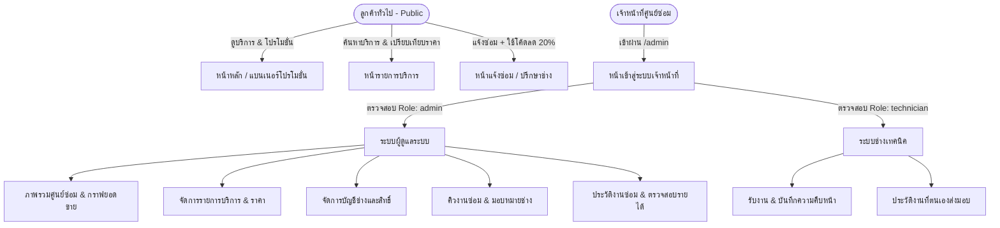
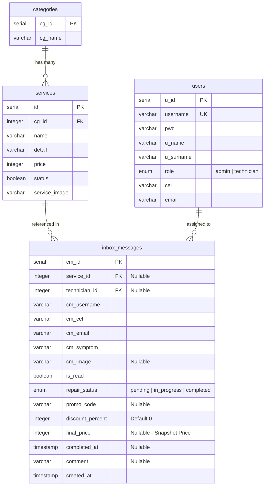

# 🛠️ FixPlease (FP) - Electronic Repair Service & Management System v2.0

> **ระบบแจ้งซ่อมและบริหารจัดการงานซ่อมอุปกรณ์ไอทีครบวงจร (Computer, Laptop, Smartphone)**  
> พัฒนาด้วยสถาปัตยกรรมแบบแยกส่วน **Fullstack Monorepo**:  
> - **Frontend:** React 19 + Vite + Tailwind CSS v4 + React Router v7 + Lucide Icons  
> - **Backend:** Bun + Express + TypeScript + Drizzle ORM + PostgreSQL (Neon Serverless)  
> - **Security & Auth:** HttpOnly Cookie, JWT Real-time DB Verification, Rate Limiting & Strict RBAC  
> - **Deployment:** Vercel Serverless Architecture (Backend API + Frontend SPA with Static Fallback Routing)

---

## 📋 สารบัญ (Table of Contents)

1. [จุดเด่นและการปรับปรุงใหม่ในเวอร์ชัน 2.0 (What's New in v2.0)](#-จุดเด่นและการปรับปรุงใหม่ในเวอร์ชัน-20)
2. [ภาพรวมของระบบและบทบาทผู้ใช้งาน (System Overview & User Roles)](#-ภาพรวมของระบบและบทบาทผู้ใช้งาน)
3. [โครงสร้างโปรเจกต์ (Project Directory Structure)](#-โครงสร้างโปรเจกต์)
4. [ระบบโค้ดส่วนลดโปรโมชั่น 20% (Promotion Code Engine)](#-ระบบโค้ดส่วนลดโปรโมชั่น-20)
5. [การจัดการฐานข้อมูล (Database Schema & Drizzle ORM)](#-การจัดการฐานข้อมูล)
6. [ตารางสรุป API Endpoints ทั้งหมด (Comprehensive API Reference)](#-ตารางสรุป-api-endpoints-ทั้งหมด)
7. [สถาปัตยกรรมความปลอดภัยและการล็อกยอดขาย (Security & Revenue Integrity)](#-สถาปัตยกรรมความปลอดภัยและการล็อกยอดขาย)
8. [ขั้นตอนการติดตั้งและเริ่มใช้งานในเครื่อง (Local Getting Started)](#-ขั้นตอนการติดตั้งและเริ่มใช้งานในเครื่อง)
9. [การนำขึ้นระบบ Production บน Vercel + Neon (Deployment Guide)](#-การนำขึ้นระบบ-production-บน-vercel--neon)

---

## 🌟 จุดเด่นและการปรับปรุงใหม่ในเวอร์ชัน 2.0

เวอร์ชันนี้ได้รับการยกระดับทั้งในด้าน **UI/UX**, **Business Logic**, **ความถูกต้องของข้อมูลทางการเงิน** และ **ความปลอดภัยของระบบ**:

1. **Brand Identity & Favicon ใหม่**:
   - ใช้โลโก้ทางการ **"FP (FixPlease)"** ดีไซน์ทันสมัยสี Dark Charcoal พร้อมลูกเล่นประแจ Negative-space และแถบสีฟ้า บนแท็บ Favicon, แถบ Navbar, ท้ายเว็บ Footer, หน้าล็อกอิน และ Sidebar หลังบ้าน
2. **ทางเข้าหลังบ้านที่ปลอดภัย (Hidden Admin Portal)**:
   - นำปุ่มล็อกอินออกจากแถบเมนูสาธารณะ ป้องกันผู้ใช้ทั่วไปสับสน
   - เข้าหน้าล็อกอินสำหรับเจ้าหน้าที่ผ่าน URL `/admin` เท่านั้น (ระบบจะตรวจสอบสิทธิ์และ Redirect ไปยังหน้าทำงานตามตำแหน่งอัตโนมัติ)
3. **ระบบคิวงาน 3 สถานะสมบูรณ์แบบ (3-Step Repair Lifecycle)**:
   - `pending` (รอรับงานซ่อม): งานใหม่ที่ส่งเข้ามา ลูกค้ายังไม่ระบุบริการ หรือรอการมอบหมาย
   - `in_progress` (รับงานซ่อม / กำลังดำเนินการ): ช่างกดรับงานหรือเริ่มลงมือซ่อม พร้อมผูกชื่อช่างผู้รับผิดชอบ
   - `completed` (ส่งมอบงานซ่อมเรียบร้อย): คิดเงิน บันทึก `final_price` และเวลาปิดงาน `completed_at` ถาวร
4. **ระบบโค้ดโปรโมชั่นลด 20% ใช้งานได้จริงครบวงจร (End-to-End Promotion)**:
   - แบนเนอร์โปรโมชั่นหน้าแรกมีปุ่มคัดลอกโค้ดและปุ่ม *"ใช้สิทธิ์แจ้งซ่อม"* ที่ส่งโค้ด `HALLOWEEN20` เข้าฟอร์มอัตโนมัติ
   - ฟอร์มหน้า About คำนวณส่วนลดสด (Live Breakdown): ราคาปกติ -> หักส่วนลด 20% -> ยอดประเมินสุทธิ
   - ระบบหลังบ้านบันทึกโค้ด, แสดงป้ายเตือนช่าง และคำนวณหักส่วนลด 20% เข้าสู่ยอดเงินจริงอย่างถูกต้อง
5. **หน้าประวัติงานซ่อมและติดตามผลงานช่าง (`/admin/history`)**:
   - แยกงานที่ส่งมอบแล้วออกจากคิวงานปัจจุบันอย่างชัดเจน
   - มีตารางสรุปผลงานช่างแต่ละคน (Technician Track Record) ช่วยติดตามจำนวนงานและป้องกันการอู้งาน
   - ออกใบเสร็จสรุปงานซ่อม (Receipt Modal) พร้อมรายละเอียดอะไหล่ บันทึกช่าง และยอดสุทธิ
6. **ระบบสิทธิ์ช่างเทคนิคที่รัดกุม (Technician Isolation)**:
   - ช่าง **ไม่มีสิทธิ์เห็นหรือเข้าหน้า Dashboard และหน้าจัดการผู้ใช้เด็ดขาด** (Redirect ทันที)
   - ช่างไม่สามารถแก้ไขหรือแทรกแซงงานของช่างท่านอื่นได้
7. **จัดหน้ารวมบริการแบบ Unified Single-Block**:
   - รวมการค้นหา กรองหมวดหมู่ และแสดงผลไว้ในการ์ดเดียว ไม่มีการ์ดซ้ำซ้อนด้านล่าง
   - เมื่อเลือกตัวกรอง *"ทั้งหมด"* ระบบจะจัดกลุ่มแยกตามหมวดหมู่อัตโนมัติ (Auto-Grouped)
8. **Navbar & Responsive Layout สมดุล**:
   - Navbar เมนูอยู่กึ่งกลางหน้าจออย่างสมบูรณ์แบบ (Balanced 3-Column Flex)
   - ปรับการตัดคำภาษาไทย (`text-pretty` / `inline-block`) ป้องกันประโยคถูกหั่นครึ่ง
   - รองรับหน้าจอมือถือ แสดงการ์ดบริการแบบ 2 คอลัมน์กะทัดรัด เห็นได้ 2-4 รายการต่อหน้าจอ

---

## 👥 ภาพรวมของระบบและบทบาทผู้ใช้งาน



### 1. ลูกค้าทั่วไป (Public Customers)
- **หน้าแรก (Home):**
  - ชมภาพรวมศูนย์บริการ มาตรฐานการตรวจเช็ค และจุดเด่น (รับประกัน 90 วัน, ตรวจเช็คฟรี, ไม่เข้าถึงข้อมูลส่วนตัว)
  - แบนเนอร์โปรโมชั่นประจำเดือน แสดงโค้ดลด 20% พร้อมปุ่มคัดลอก และปุ่มคลิกเพื่อใช้สิทธิ์
- **หน้ารวมบริการ (Services):**
  - ค้นหาและกรองบริการตามประเภท (Computer, Laptop, Phone)
  - แสดงผลใน Block เดียว โดยเมื่อเลือก *"ทั้งหมด"* จะแยกหมวดหมู่อัตโนมัติ พร้อมปุ่มกด *"เลือกบริการนี้"*
- **หน้าเกี่ยวกับเราและส่งซ่อม (About Us & Contact):**
  - ดูข้อมูลติดต่อ ที่ตั้ง และเวลาทำการ (แถบ Dark Slate สวยงาม แยกสัดส่วนชัดเจน)
  - ฟอร์มแจ้งซ่อมออนไลน์: เลือกรุ่น, รายการบริการ (หรือเลือกปรึกษาช่างก่อน), ข้อมูลติดต่อ และแนบรูป
  - กล่องใส่โค้ดส่วนลดโปรโมชั่น: กรอก `HALLOWEEN20` เพื่อรับส่วนลด 20% ทันที พร้อมแสดงการคำนวณราคาสด

### 2. ช่างซ่อมประจำศูนย์ (Technicians)
- เข้าสู่ระบบผ่านพาธ `/admin` (ระบบจะนำทางไปยัง `/admin/inbox` ทันที และล็อกไม่ให้เข้าหน้า Dashboard หรือ Users)
- **การจัดการคิวงานซ่อม (`/admin/inbox`):**
  - กรองงานตามสถานะ: *รอรับงาน (Pending)* หรือ *กำลังซ่อม (In Progress)*
  - กรองเฉพาะงานที่ยังไม่มีผู้รับผิดชอบ หรืองานในหมวดหมู่อุปกรณ์ที่ตนเองถนัด
  - กด **"รับงานซ่อมนี้"** ระบบจะผูกชื่อของช่างคนนั้นเข้ากับใบงานอัตโนมัติ
  - เลือกบริการที่ซ่อมจริง และบันทึกรายละเอียดความคืบหน้าลงในช่องบันทึกของช่าง
  - เมื่อซ่อมและทดสอบเครื่องเสร็จสิ้น กด **"ส่งมอบงานซ่อม"** เพื่อบันทึกรายได้สุทธิและย้ายงานเข้าสู่ประวัติ
- **การตรวจสอบผลงาน (`/admin/history`):**
  - ดูประวัติงานซ่อมที่ตนเองเป็นผู้ปิดงาน พร้อมตรวจสอบรายรับรวมที่ตนเองทำได้

### 3. ผู้ดูแลระบบ (System Administrators)
- สิทธิ์สูงสุดในการควบคุมระบบหลังบ้านแบบ Full Control:
  1. **แดชบอร์ดภาพรวม (`/admin/dashboard`):**
     - ตรวจสอบยอดรายรับสุทธิสะสม (คำนวณจากยอดที่หักโปรโมชั่นและส่งมอบแล้วจริง)
     - กรองดูยอดขายย้อนหลัง 7 วัน (Weekly) หรือ 30 วัน (Monthly)
     - ดูกราฟสัดส่วนรายได้แยกตามหมวดหมู่ และสถิติจำนวนงานของช่างแต่ละคน
  2. **จัดการบริการและค่าซ่อม (`/admin/services`):**
     - เพิ่ม, แก้ไข, ลบรายการบริการ กำหนดราคามาตรฐาน และเปิด/ปิดการแสดงผลบนหน้าเว็บ
  3. **จัดการคิวงานซ่อม (`/admin/inbox`):**
     - มอบหมายช่างผู้รับผิดชอบงานให้กับช่างคนใดก็ได้
     - ลบใบแจ้งซ่อมที่เป็นสแปมหรือข้อมูลผิดพลาด (ไม่อนุญาตให้ลบงานที่ส่งมอบแล้ว)
  4. **ประวัติงานซ่อมและใบเสร็จ (`/admin/history`):**
     - ค้นหาประวัติย้อนหลังตามชื่อลูกค้า เบอร์โทร ช่าง หรือช่วงเวลา
     - เปิดดูใบเสร็จสรุปงานซ่อม (Digital Receipt) พร้อมแท็กโค้ดโปรโมชั่นที่ใช้
  5. **จัดการผู้ใช้งานและสิทธิ์ (`/admin/users`):**
     - เพิ่มหรือแก้ไขข้อมูลเจ้าหน้าที่ กำหนดสิทธิ์เป็น Admin หรือ Technician พร้อมรีเซ็ตรหัสผ่าน

---

## 📁 โครงสร้างโปรเจกต์

```text
Starter-Website-Intern/
├── backend/                              # ฝั่ง Backend API Server
│   ├── drizzle/                          # ไฟล์ SQL Migrations
│   │   ├── 0000_even_thunderbolt_ross.sql
│   │   ├── 0001_mysterious_meltdown.sql
│   │   ├── 0002_billing_and_history.sql
│   │   ├── 0003_add_in_progress_status.sql      # เพิ่ม Enum 'in_progress'
│   │   └── 0004_add_promo_code_to_inbox.sql     # เพิ่ม promo_code & discount_percent
│   ├── src/
│   │   ├── config/
│   │   │   ├── db.ts                     # เชื่อมต่อ Neon Postgres ด้วย postgres.js & drizzle
│   │   │   └── env.ts                    # ตรวจสอบตัวแปรสภาพแวดล้อม (JWT, CORS, Port)
│   │   ├── controllers/                  # Business Logic Controllers
│   │   │   ├── auth.controller.ts        # ระบบยืนยันตัวตน, Session, HttpOnly Cookie
│   │   │   ├── categories.controller.ts  # จัดการหมวดหมู่อุปกรณ์
│   │   │   ├── dashboard.controller.ts   # สรุปสถิติและคำนวณรายได้แบบ Parallel Queries
│   │   │   ├── inbox.controller.ts       # จัดการคิวงาน, มอบหมายช่าง, ส่วนลด และส่งมอบงาน
│   │   │   ├── services.controller.ts    # จัดการรายการซ่อมและราคา
│   │   │   └── users.controller.ts       # จัดการบัญชีผู้ใช้และ Role
│   │   ├── db/
│   │   │   ├── schema.ts                 # Drizzle Schema (Tables, Enums, Indexes, Relations)
│   │   │   └── seed.ts                   # สคริปต์สร้างข้อมูลเริ่มต้น
│   │   ├── middlewares/                  # Express Middlewares
│   │   │   ├── auth.middleware.ts        # แกะ JWT และตรวจสอบข้อมูลจาก DB แบบ Real-time
│   │   │   ├── error.middleware.ts       # กลไกดักจับ Error กลาง
│   │   │   ├── rateLimit.middleware.ts   # ป้องกัน Brute-force & Spam
│   │   │   ├── role.middleware.ts        # บังคับสิทธิ์ Admin / Technician
│   │   │   └── validate.middleware.ts    # ตรวจสอบ Payload ด้วย Zod
│   │   ├── routes/                       # รวม Express Router ทั้งหมด
│   │   ├── validators/                   # Zod Validation Schemas
│   │   └── index.ts                      # Entry Point เซิร์ฟเวอร์ Backend
│   ├── package.json
│   └── tsconfig.json
│
├── frontend/                             # ฝั่ง Frontend Web Application
│   ├── public/
│   │   ├── logo.jpg                      # โลโก้แบรนด์สำหรับ Favicon แท็บเบราว์เซอร์
│   │   └── favicon.svg
│   ├── src/
│   │   ├── api/
│   │   │   └── client.ts                 # Fetch Wrapper พร้อมส่ง Cookie Credentials อัตโนมัติ
│   │   ├── assets/                       # ไฟล์รูปภาพ (โลโก้ FP, ภาพห้องซ่อม, แบนเนอร์โปร)
│   │   ├── components/
│   │   │   ├── layout/
│   │   │   │   ├── Navbar.tsx            # แถบเมนูด้านบน จัดกึ่งกลางสมมาตร
│   │   │   │   └── Footer.tsx            # ส่วนท้ายเว็บไซต์ พร้อมข้อมูลติดต่อครบครัน
│   │   │   └── ui/
│   │   │       └── ImageLightbox.tsx     # กล่องดูรูปภาพขยายแบบเต็มจอ
│   │   ├── context/
│   │   │   ├── AuthContext.tsx           # จัดการสถานะการล็อกอินและข้อมูลผู้ใช้
│   │   │   └── ServiceContext.tsx        # แคชข้อมูลบริการ หมวดหมู่ และ Toast Notification
│   │   ├── pages/
│   │   │   ├── Home/HomePage.tsx         # หน้าแรก พร้อมแบนเนอร์โปรโมชั่นลด 20%
│   │   │   ├── Services/ServicesPage.tsx # หน้ารวมบริการจัดกลุ่มอัตโนมัติใน Block เดียว
│   │   │   ├── AboutMe/AboutPage.tsx     # หน้าเกี่ยวกับเรา & ฟอร์มแจ้งซ่อมพร้อมคำนวณส่วนลด
│   │   │   ├── Login/LoginPage.tsx       # หน้าเข้าสู่ระบบสำหรับเจ้าหน้าที่
│   │   │   └── Admin/                    # ระบบหลังบ้าน
│   │   │       ├── AdminLayout.tsx       # โครงร่างหลังบ้านพร้อม Fixed Sidebar
│   │   │       ├── AdminDashboard.tsx    # สรุปสถิติ ยอดขายสะสม และผลงานช่าง
│   │   │       ├── AdminServices.tsx     # จัดการรายการซ่อม เพิ่ม/ลบ/แก้ไข/เปิด-ปิด
│   │   │       ├── AdminInbox.tsx        # คิวงานซ่อม อัปเดต 3 สถานะ และคำนวณยอดสุทธิ
│   │   │       ├── AdminHistory.tsx      # ประวัติงานซ่อม ใบเสร็จ และสถิติช่าง
│   │   │       └── AdminUsers.tsx        # จัดการผู้ใช้งานและสิทธิ์เจ้าหน้าที่
│   │   ├── types/index.ts                # รวม Type Definitions ทั้งหมดของระบบ
│   │   ├── App.tsx                       # ตั้งค่าเส้นทาง Routing และระบบป้องกันสิทธิ์
│   │   ├── index.css                     # Tailwind CSS v4 Global Styles
│   │   └── main.tsx
│   ├── index.html
│   ├── package.json
│   ├── tsconfig.json
│   └── vite.config.ts                    # Vite Config พร้อม vercelSpaStaticFallback Plugin
│
├── vercel.json                           # การตั้งค่า Vercel Multi-Service Routing
├── README.md                             # คู่มือฉบับย่อเริ่มต้น
└── readme2.md                            # คู่มือระบบฉบับสมบูรณ์ v2.0 (ไฟล์นี้)
```

---

## 🎟️ ระบบโค้ดส่วนลดโปรโมชั่น 20% (Promotion Code Engine)

ระบบโปรโมชั่นถูกออกแบบมาเพื่อกระตุ้นยอดแจ้งซ่อมผ่านหน้าเว็บ โดยคำนวณและบันทึกข้อมูลอย่างแม่นยำตลอดกระบวนการ:

```text
[ลูกค้าเห็นแบนเนอร์] ───> [คลิก "ใช้สิทธิ์แจ้งซ่อม"]
                             │
                             ▼
[เปิดฟอร์มแจ้งซ่อม /about?promo=HALLOWEEN20#contact]
  ├── ระบบ Pre-fill โค้ด HALLOWEEN20 ให้ทันที
  ├── เลือกรุ่น/บริการ: ระบบคำนวณสด (เช่น ฿1,000 -> ลด 20% (-฿200) -> ยอดสุทธิ ฿800)
  └── กดส่งข้อมูล: บันทึก promo_code และ discount_percent = 20 ลงฐานข้อมูล
                             │
                             ▼
[ช่าง/แอดมินเปิดดูคิวงานใน /admin/inbox]
  ├── มีป้ายกำกับสีทองแจ้งเตือน: "🏷️ HALLOWEEN20 (-20%)"
  ├── ดำเนินการตรวจเช็คและซ่อมเครื่อง (สถานะ in_progress)
  └── เมื่อกด "ส่งมอบงานซ่อม" (สถานะ completed):
        คำนวณ final_price = ราคาบริการ * 0.8 (฿800) ลง Database ถาวร
                             │
                             ▼
[สรุปยอดเข้า Dashboard และประวัติงานซ่อม]
  ├── ยอดรายรับสะสมคำนวณจาก final_price (฿800) ตรงตามเงินที่รับจริง
  └── ในใบเสร็จประวัติงานซ่อมแสดงรายละเอียดส่วนลด 20% ครบถ้วน
```

### รายละเอียดทางเทคนิค
- **โค้ดที่รองรับ:** `HALLOWEEN20`, `PROMO20`, `FIX20` (Case-insensitive)
- **อัตราส่วนลด:** 20% ของราคาบริการประเมิน
- **กรณีลูกค้ายังไม่ระบุบริการ:** ระบบจะบันทึกสิทธิ์โค้ดส่วนลดติดไว้กับใบแจ้งซ่อม เมื่อช่างตรวจเช็คและเลือกบริการที่ซ่อมจริงในหน้าหลังบ้าน ระบบจะนำส่วนลด 20% ไปคำนวณให้อัตโนมัติ

---

## 🗄️ การจัดการฐานข้อมูล (Database Schema & Drizzle ORM)

ระบบใช้ **Neon Serverless PostgreSQL** ร่วมกับ **Drizzle ORM** ในการจัดการ Schema และความสัมพันธ์:



### คำสั่งจัดการ Database ผ่าน CLI (`backend/package.json`):

| คำสั่ง | หน้าที่การทำงาน |
| :--- | :--- |
| `bun run db:push` | ซิงค์ Drizzle Schema ไปยังฐานข้อมูล Neon ทันที (ไม่ต้องใช้ migration file) |
| `bun run db:generate` | สร้างไฟล์ Migration `.sql` ในโฟลเดอร์ `drizzle/` ตามความเปลี่ยนแปลงของ Schema |
| `bun run db:migrate` | ดำเนินการรัน Migration Files ที่ยังค้างอยู่ไปยังฐานข้อมูล |
| `bun run db:seed` | นำเข้าข้อมูลหมวดหมู่, บริการตัวอย่าง และบัญชี Admin/ช่าง เริ่มต้นจากไฟล์ `.env` |
| `bun run db:studio` | เปิด Drizzle Studio บน Web Browser เพื่อตรวจสอบและแก้ไขข้อมูลในตารางโดยตรง |

---

## 📡 ตารางสรุป API Endpoints ทั้งหมด

Base URL: `http://localhost:5000/api` (เมื่อรันบน Local) หรือ `/api` (เมื่อรันบน Vercel)

### 1. หมวดหมู่การยืนยันตัวตน (`/api/auth`)

| Method | Endpoint | สิทธิ์การเข้าถึง | หน้าที่การทำงาน | ตัวอย่าง Payload / หมายเหตุ |
| :--- | :--- | :--- | :--- | :--- |
| `POST` | `/api/auth/login` | Public (Rate Limited) | เข้าสู่ระบบ และฝัง HttpOnly Cookie (`auth_token`) | `{ "username": "Admin", "pwd": "..." }` |
| `POST` | `/api/auth/logout` | Public | ออกจากระบบ และลบ HttpOnly Cookie | เคลียร์ Token ฝั่งเซิร์ฟเวอร์ |
| `GET` | `/api/auth/me` | Authenticated | ดึงโปรไฟล์ผู้ใช้ปัจจุบัน (ตรวจเช็กกับ DB สดทุกครั้ง) | ส่งคืนข้อมูล User และ Role |

### 2. หมวดหมู่รายการบริการ (`/api/categories`)

| Method | Endpoint | สิทธิ์การเข้าถึง | หน้าที่การทำงาน | ตัวอย่าง Payload / หมายเหตุ |
| :--- | :--- | :--- | :--- | :--- |
| `GET` | `/api/categories` | Public | ดึงรายชื่อหมวดหมู่ทั้งหมด | รองรับ Query `?fresh=1` เพื่อ Bypass Cache |
| `GET` | `/api/categories/:id` | Public | ดูรายละเอียดหมวดหมู่ตามรหัส `cg_id` | - |
| `POST` | `/api/categories` | Admin Only | เพิ่มหมวดหมู่อุปกรณ์ใหม่ | `{ "cg_name": "Smart Watch" }` |

### 3. รายการบริการและราคาซ่อม (`/api/services`)

| Method | Endpoint | สิทธิ์การเข้าถึง | หน้าที่การทำงาน | ตัวอย่าง Payload / หมายเหตุ |
| :--- | :--- | :--- | :--- | :--- |
| `GET` | `/api/services` | Public | ดึงรายการบริการทั้งหมด | Query: `?cg_id=1&status=true&fresh=1` |
| `GET` | `/api/services/:id` | Public | ดูรายละเอียดบริการเดี่ยวตาม ID | - |
| `POST` | `/api/services` | Admin Only | เพิ่มรายการบริการซ่อมใหม่ | `{ "name": "...", "cg_id": 1, "price": 1200, "detail": "...", "service_image": "...", "status": true }` |
| `PUT` | `/api/services/:id` | Admin Only | แก้ไขข้อมูลบริการซ่อม | แก้ไขราคา ชื่อ รายละเอียด หรือสถานะเปิด/ปิด |
| `DELETE` | `/api/services/:id` | Admin Only | ลบบริการซ่อมออกจากระบบ | ป้องกันการลบหากมีข้อความผูกอยู่ |

### 4. กล่องข้อความและคิวงานซ่อม (`/api/inbox`)

| Method | Endpoint | สิทธิ์การเข้าถึง | หน้าที่การทำงาน | ตัวอย่าง Payload / หมายเหตุ |
| :--- | :--- | :--- | :--- | :--- |
| `POST` | `/api/inbox` | Public (Rate Limited) | ลูกค้าส่งแบบฟอร์มแจ้งซ่อม / ปรึกษาช่าง | `{ "cm_username": "...", "cm_cel": "081-xxx-xxxx", "cm_email": "...", "cm_symptom": "...", "service_id": 1, "promo_code": "HALLOWEEN20" }` |
| `GET` | `/api/inbox` | Staff (Admin/ช่าง) | ดึงรายการคิวงานซ่อมทั้งหมด | Query: `?repair_status=active&read_status=all&search=...` |
| `GET` | `/api/inbox/:id` | Staff (Admin/ช่าง) | ดูข้อมูลงานซ่อมรายตัว (ไม่มี Side-effect) | ส่งคืนข้อมูลลูกค้า อาการ และประวัติช่าง |
| `PATCH` | `/api/inbox/:id/read` | Staff (Admin/ช่าง) | อัปเดตสถานะเป็น "อ่านแล้ว" (`is_read: true`) | เรียกอัตโนมัติเมื่อเปิดดูรายละเอียด |
| `PATCH` | `/api/inbox/:id/status` | Staff (Admin/ช่าง) | ปรับสถานะงาน (`pending`, `in_progress`, `completed`), มอบหมายช่าง, บันทึกความคืบหน้า และคิดเงิน | `{ "repair_status": "in_progress", "service_id": 2, "comment": "..." }` |
| `DELETE` | `/api/inbox/:id` | Admin Only | ลบใบแจ้งซ่อมออกจากระบบ | **ห้ามลบรายการที่สถานะเป็น `completed`** |

### 5. ผู้ใช้งานระบบและบัญชีเจ้าหน้าที่ (`/api/users`)

| Method | Endpoint | สิทธิ์การเข้าถึง | หน้าที่การทำงาน | ตัวอย่าง Payload / หมายเหตุ |
| :--- | :--- | :--- | :--- | :--- |
| `GET` | `/api/users` | Staff (Admin/ช่าง) | ดึงรายชื่อช่างและเจ้าหน้าที่ทั้งหมด (ตัดรหัสผ่านออก) | นำไปใช้แสดงใน Dropdown มอบหมายงาน |
| `GET` | `/api/users/:id` | Admin Only | ดูข้อมูลผู้ใช้งานรายบุคคล | - |
| `POST` | `/api/users` | Admin Only | สร้างบัญชีผู้ใช้ใหม่ (เข้ารหัสรหัสผ่านด้วย bcrypt) | `{ "username": "...", "pwd": "...", "u_name": "...", "u_surname": "...", "role": "technician", ... }` |
| `PUT` | `/api/users/:id` | Admin Only | แก้ไขข้อมูลผู้ใช้และเปลี่ยนรหัสผ่าน | ปรับสิทธิ์ Role หรือเปลี่ยนชื่อ-นามสกุล |
| `DELETE` | `/api/users/:id` | Admin Only | ลบบัญชีผู้ใช้ | มี Guard ป้องกันไม่ให้ Admin ลบบัญชีตัวเอง |

### 6. แดชบอร์ดสรุปผลและสถิติ (`/api/dashboard`)

| Method | Endpoint | สิทธิ์การเข้าถึง | หน้าที่การทำงาน | ตัวอย่าง Payload / หมายเหตุ |
| :--- | :--- | :--- | :--- | :--- |
| `GET` | `/api/dashboard` | Admin Only | คำนวณสรุปยอดรายได้สุทธิสะสม, กรองช่วงเวลา (All / Weekly 7 วัน / Monthly 30 วัน), จำนวนงานที่สำเร็จ, จำนวนงานรอซ่อม, สัดส่วนรายได้แยกตามหมวด และผลงานช่าง | Query: `?period=all` \| `weekly` \| `monthly` (รัน 7 Queries แบบขนานเพื่อความเร็วสูงสุด) |

---

## 🔒 สถาปัตยกรรมความปลอดภัยและการล็อกยอดขาย

### 1. ระบบยืนยันตัวตนระดับสูง (Security & Session Integrity)
- **HttpOnly & SameSite Cookies:** Token ถูกเก็บในคุกกี้ที่ไม่สามารถเข้าถึงได้ผ่าน JavaScript ฝั่ง Client ป้องกันการถูกโจมตีแบบ XSS
- **Real-time DB Identity Check:** ทุกครั้งที่มีการเรียก API ระบบจะนำรหัสจาก Token ไปค้นหาข้อมูลผู้ใช้และ Role จากฐานข้อมูล Neon โดยตรง หากบัญชีถูกปิดหรือเปลี่ยนตำแหน่ง สิทธิ์จะเปลี่ยนทันทีโดยไม่ต้องรอ Token หมดอายุ
- **Rate Limiting:** จำกัดการยิง API ในส่วนที่สำคัญเพื่อป้องกัน Brute-force รหัสผ่านที่ `/api/auth/login` และป้องกันบอทยิงสแปมที่ฟอร์มแจ้งซ่อม `/api/inbox`

### 2. การล็อกยอดขายและการปกป้องประวัติทางการเงิน (Revenue Snapshot Integrity)
- **ปัญหาเดิมในระบบทั่วไป:** หากลูกค้านำเครื่องมาซ่อมราคา ฿1,000 ต่อมาแอดมินแก้ไขราคาบริการนั้นเป็น ฿1,500 หรือลบบริการทิ้ง ยอดขายย้อนหลังจะเพี้ยนทันที
- **การแก้ไขใน FixPlease v2.0:**
  1. เมื่อกดส่งมอบงาน (`completed`) ระบบจะ Snapshot ราคา ณ ขณะนั้นลงในฟิลด์ `final_price` และบันทึกเวลาลงใน `completed_at`
  2. หากมีโค้ดส่วนลดโปรโมชั่น 20% ระบบจะคำนวณหักส่วนลดและบันทึกราคาสุทธิตามจริงทันที
  3. **Permanent Lock Rule:** ใบงานที่ส่งมอบแล้ว **ห้ามย้อนสถานะกลับเป็นรอดำเนินการ และห้ามเปลี่ยนรายการบริการเด็ดขาด** ทำให้ยอดขายสะสมในระบบถูกต้องแม่นยำ 100% ตลอดไป

---

## 💻 ขั้นตอนการติดตั้งและเริ่มใช้งานในเครื่อง

### ความต้องการเบื้องต้น
- [Bun](https://bun.sh/) (แนะนำเวอร์ชัน 1.1 ขึ้นไป)
- บัญชีฐานข้อมูล PostgreSQL (แนะนำ [Neon.tech](https://neon.tech) หรือ Local Postgres)

### 1. โคลนและติดตั้ง Dependencies

```bash
# ติดตั้ง dependencies สำหรับ Backend
cd backend
bun install

# ติดตั้ง dependencies สำหรับ Frontend
cd ../frontend
bun install
```

### 2. ตั้งค่า Environment Variables (`backend/.env`)

สร้างไฟล์ `backend/.env` โดยใส่ค่าดังนี้:

```env
PORT=5000
NODE_ENV=development
CLIENT_URL=http://localhost:3000

# Connection String จาก Neon Database
DATABASE_URL="postgresql://neondb_owner:<password>@<neon-host>/neondb?sslmode=require&channel_binding=require"

# คีย์ลับสำหรับเซ็น JWT (ห้ามเปิดเผย)
JWT_SECRET="fixplease_super_secret_jwt_key_2026"

# บัญชีเริ่มต้นสำหรับการรันคำสั่ง Seed
SEED_ADMIN_USERNAME=Admin
SEED_ADMIN_PASSWORD=AdminPass1234!
SEED_TECH_USERNAME=TechSomchai
SEED_TECH_PASSWORD=TechPass1234!
```

### 3. รัน Migration และสร้างข้อมูลเริ่มต้น

```bash
cd backend
bun run db:push
bun run db:seed
```

### 4. รันระบบสำหรับการพัฒนา (Development)

เปิด 2 หน้าต่าง Terminal:

```bash
# Terminal 1: Backend API (พอร์ต 5000)
cd backend
bun run dev

# Terminal 2: Frontend Web App (พอร์ต 3000)
cd frontend
bun run dev
```

เปิดเบราว์เซอร์เข้าใช้งานที่: **`http://localhost:3000`**  
เข้าสู่ระบบหลังบ้านที่: **`http://localhost:3000/admin`**

---

## ☁️ การนำขึ้นระบบ Production บน Vercel + Neon

โปรเจกต์นี้ได้รับการปรับแต่งโครงสร้างให้ Deploy บน **Vercel** แบบ Serverless Monorepo ได้ทันที:

### 1. การทำงานของ `vercel.json`
ไฟล์ `vercel.json` ที่ Root กำหนด Route อย่างชัดเจน:
- เส้นทาง `/api/(.*)` ส่งต่อไปยัง Express Serverless Handler ของฝั่ง `backend`
- เส้นทางอื่นๆ ส่งต่อไปยัง Static Assets ของฝั่ง `frontend`

### 2. ปลั๊กอินป้องกัน 404 เมื่อ Refresh หน้าเว็บ (`vercelSpaStaticFallback`)
ในไฟล์ `frontend/vite.config.ts` มีปลั๊กอิน `vercelSpaStaticFallback` ที่จะสร้างไฟล์ HTML สำรองสำหรับเส้นทาง SPA ยอดนิยม เช่น `/services`, `/about`, `/admin`, `/admin/inbox`, `/admin/history` ฯลฯ ในขั้นตอนการ Build ทำให้ผู้ใช้สามารถกด Refresh หรือเปิดลิงก์ตรงได้โดยไม่เกิดปัญหา 404 Not Found บน Vercel

### 3. การตั้งค่า Environment Variables บน Vercel Dashboard
ในโปรเจกต์บน Vercel ให้กำหนดตัวแปรในแท็บ **Settings > Environment Variables**:
- `DATABASE_URL`: Connection string จาก Neon Postgres
- `JWT_SECRET`: คีย์ลับ JWT
- `NODE_ENV`: `production`

---

## 📜 ลิขสิทธิ์และผู้พัฒนา (License & Credits)

- **โครงการ:** FixPlease Repair Studio - Starter Website Intern
- **เทคโนโลยีหลัก:** Bun, React 19, TypeScript, Tailwind CSS v4, Express, Drizzle ORM, Neon PostgreSQL
- **สงวนลิขสิทธิ์:** พัฒนาขึ้นเพื่อการศึกษาและการใช้งานระบบศูนย์บริการซ่อมมาตรฐาน
